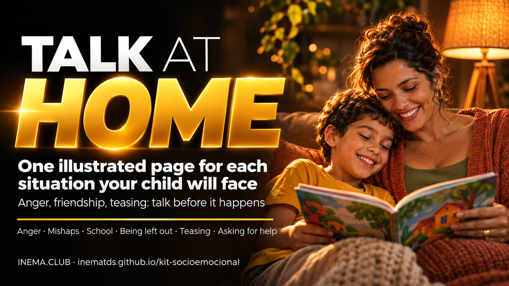

# Talk at Home

[](https://inematds.github.io/kit-socioemocional/guia/en/)

**🇧🇷 [Português](README.md) · 🇺🇸 [English](README.en.md) · 🇪🇸 [Español](README.es.md)**

## What it is

Talk at Home is a free kit of illustrated pages for parents, teachers, and caregivers to read with children ages 3 to 13. Each page shows a common situation (anger, a broken toy, a classmate who teases) and what the child can do, step by step, without retaliating and asking for help when needed. Children don't need to know how to read: they follow the pictures while you read the text. Available now are a map with 128 situations in two volumes and a pilot with 5 pages to download and print, in 2D illustration or 3D.

## 📖 Guide

Full page: **https://inematds.github.io/kit-socioemocional/guia/en/**

📄 Pilot PDF (5 pages, A4): [2D illustration](guia/assets/conversa-em-casa-piloto-desenho.pdf) · [3D](guia/assets/conversa-em-casa-piloto-3d.pdf) · 🗺️ Map of 128 situations: [MAPA.md (in Portuguese)](MAPA.md)

🎬 Video: in production.

## The 5 steps on every page

**Notice → Stop → Think → Act → Ask for help.** In Volume 1 (*What I feel*), each step becomes a comic panel. In Volume 2 (*I get along and keep myself safe*), the page shows the scene, what doesn't help, what the child can try saying, and who can help.

Fixed rule for Volume 2: never teach retaliation or mockery; safety comes before any object; an adult must always be involved when there is force, a threat, a group, or repeated behavior. The chapter "My body belongs to me" will only be released after expert review.

## Want a page about your child's situation?

Paste this into Claude Code or Codex:

```
Read the github.com/inematds/kit-socioemocional repository, especially MAPA.md and the piloto/roteiro.json file.
My child is [AGE] years old and is going through this: [DESCRIBE THE SITUATION IN 2 OR 3 SENTENCES].
Write a new page in the same format as the kit (Volume 1 for an emotion or unexpected event; Volume 2 for getting along), with the 5 steps, a ready-to-use phrase for the child to say, who can help, and two questions for us to discuss.
Rules: no retaliation or mockery, language suited to their age, and show me only the text. Do not generate images or change files until I say so.
```

## Based on

- **Social Stories** (Carol Gray, 1993): a situation shown before it happens, in the first person.
- **RULER** (Yale): recognizing, understanding, labeling, expressing, and regulating emotions.
- **Zones of Regulation**: color-coded states, strategies, and "small problem or big problem?" — [free materials](https://zonesofregulation.com/free-downloads/).
- **I Notice, I Feel, I Can** (Sesame Workshop) — [page](https://sesameworkshop.org/resources/i-notice-i-feel-i-can-2/).
- **Kidpower** (personal safety) and **Law 13.185/2015** (combating systematic bullying) — [Brazilian Ministry of Education, Bullying and School Relationships (in Portuguese)](https://www.gov.br/mec/pt-br/escola-que-protege/bullying-e-convivencia-escolar-_-entendendo.pdf).

Research on Social Stories has mixed results ([2020 review](https://link.springer.com/article/10.1007/s40489-020-00235-6)). The kit does not promise results: it opens the conversation.

---

## Technical setup

The engine turns a script into A4 pages: text-free illustrations (Agnes) + overlaid text (HTML) → PNG and PDF (Chromium).

**Prerequisites:** Python 3.10+, `ffmpeg`, Chromium (`/snap/bin/chromium` in the script; change the path if yours is different), and, to generate illustrations, the `imagens-agnes` project with `AGNES_API_KEY` (`gerar_imagens.py` imports `gerar()` from `~/projetos/imagens-agnes`). You don't need Agnes to assemble pages from images already in the repo.

| File | What it does |
|---|---|
| `MAPA.md` | the 128 situations, chapters, the 5-step framework, and page templates (in Portuguese) |
| `piloto/roteiro.json` | text for the 5 pilot pages + the English description of each illustration |
| `piloto/img/ancora-*.png` | character reference sheets (Leo, Bia, mother, teacher) and the little horse |
| `piloto/img/p*.png` | 3D illustrations for each panel, without text |
| `piloto-desenho/` | the same pilot in 2D illustration (script with a different style and its own reference sheets; `ancora-x-1.png` crops with a single view) |
| `motor/gerar_imagens.py` | generates missing illustrations with Agnes (up to 4 in parallel, 2 references per image) |
| `motor/montar_paginas.py` | builds A4 HTML, one PNG per page, and the pilot PDF in `piloto/paginas/` |
| `motor/gerar_banners.sh` | guide cover and banners (Codex `image_gen`) |

```bash
# assemble the pages and PDF from existing illustrations
python3 motor/montar_paginas.py piloto            # 3D
python3 motor/montar_paginas.py piloto-desenho    # 2D illustration
# generate missing illustrations (delete the PNG to redo a panel)
python3 motor/gerar_imagens.py piloto-desenho 009,097   # folder and pages
```

## The process, from start to finish

| # | Step | Command | Who |
|---|---|---|---|
| 1 | Choose a situation from the map and write the page in `roteiro.json` (Portuguese text + scene in English) | edit | 🧠 session with Nei |
| 2 | Create a reference sheet for each recurring character or object | `python3 ~/projetos/imagens-agnes/gerar.py "<turnaround>" --ratio 16:9 -o piloto/img/ancora-x.png` | ⚙️ script |
| 3 | Generate the panel illustrations | `python3 motor/gerar_imagens.py` | ⚙️ script |
| 4 | Check each panel (duplicate character, copied reference sheet, action not shown) and delete anything that needs redoing | inspect | 🧠 session |
| 5 | Assemble the pages and PDF | `python3 motor/montar_paginas.py piloto` | ⚙️ script |
| 6 | Independent content review (no retaliation, age-appropriate, no promises) | new `Agent` / `claude -p` | 🤖 reviewer |
| 7 | Copy pages and PDF to `guia/assets/`, translate into EN/ES, publish | `git push` | 🧠 session |

## License and use

Free for personal and school use. Content by INEMA.CLUB.