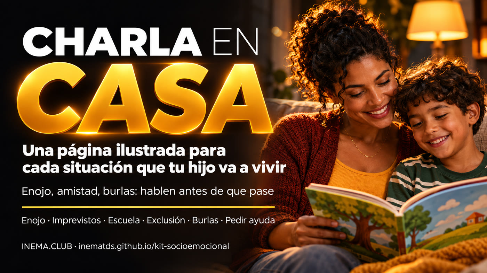

# Charla en Casa

[](https://inematds.github.io/kit-socioemocional/guia/es/)

**🇧🇷 [Português](README.md) · 🇺🇸 [English](README.en.md) · 🇪🇸 [Español](README.es.md)**

## Qué es

Charla en Casa es un kit gratuito de páginas ilustradas para que padres, docentes y cuidadores las lean con niños de 3 a 13 años. Cada página muestra una situación común (enojo, un juguete que se rompe, un compañero que molesta) y lo que el niño puede hacer, paso a paso, sin responder con agresión y pidiendo ayuda cuando la necesita. No hace falta saber leer: el niño sigue la historia con los dibujos y tú lees el texto. Actualmente están disponibles el mapa con 128 situaciones en dos volúmenes y un piloto de 5 páginas para descargar e imprimir, en estilo de dibujo o en 3D.

## 📖 Guía

Página completa: **https://inematds.github.io/kit-socioemocional/guia/es/**

📄 Piloto en PDF (5 páginas, A4): [en estilo de dibujo](guia/assets/conversa-em-casa-piloto-desenho.pdf) · [en 3D](guia/assets/conversa-em-casa-piloto-3d.pdf) · 🗺️ Mapa de las 128 situaciones: [MAPA.md](MAPA.md) (en portugués)

🎬 Video: en producción.

## Los 5 pasos de cada página

**Me doy cuenta → Me detengo → Pienso → Actúo → Pido ayuda.** En el Volumen 1 (Lo que siento), cada paso se convierte en una viñeta de la tira cómica. En el Volumen 2 (Convivo y me protejo), la página muestra la escena, qué no ayuda, qué se puede probar decir y quién puede ayudar.

Regla fija del Volumen 2: nunca enseñar a responder con agresión ni a burlarse; la seguridad está antes que cualquier objeto; si hay fuerza, amenazas, un grupo o algo que se repite, siempre debe participar un adulto. El capítulo «Mi cuerpo es mío» solo se publica después de la revisión de un especialista.

## ¿Quieres una página sobre la situación de tu hijo?

Pega esto en Claude Code o Codex:

```
Lee el repositorio github.com/inematds/kit-socioemocional, especialmente el MAPA.md y el archivo piloto/roteiro.json.
Mi hijo tiene [EDAD] años y está pasando por esto: [CUENTA LA SITUACIÓN EN 2 O 3 FRASES].
Escribe una página nueva con el mismo formato del kit (Volumen 1 si se trata de una emoción o un imprevisto; Volumen 2 si se trata de convivencia), con los 5 pasos, una frase que el niño pueda decir, quién puede ayudar y dos preguntas para conversar.
Reglas: nada de responder con agresión ni de burlarse, usa un lenguaje adecuado para su edad y muéstrame solo el texto. No generes imágenes ni modifiques archivos antes de que te dé el visto bueno.
```

## Basado en

- **Historias Sociales** (Carol Gray, 1993): situación presentada antes de que ocurra, en primera persona.
- **RULER** (Yale): reconocer, comprender, nombrar, expresar y regular la emoción.
- **Zonas de Regulación**: estados por colores, estrategias y «¿problema pequeño o grande?» — [materiales gratuitos](https://zonesofregulation.com/free-downloads/).
- **I Notice, I Feel, I Can** (Sesame Workshop) — [página](https://sesameworkshop.org/resources/i-notice-i-feel-i-can-2/).
- **Kidpower** (seguridad personal) y **Ley 13.185/2015** (prevención del acoso sistemático) — [MEC, Bullying y convivencia escolar](https://www.gov.br/mec/pt-br/escola-que-protege/bullying-e-convivencia-escolar-_-entendendo.pdf).

La investigación sobre historias sociales tiene resultados mixtos ([revisión de 2020](https://link.springer.com/article/10.1007/s40489-020-00235-6)). El kit no promete resultados: abre la conversación.

---

## Instalación técnica

El motor transforma un guion en páginas A4: ilustración sin texto (Agnes) + texto superpuesto (HTML) → PNG y PDF (Chromium).

**Requisitos previos:** Python 3.10+, `ffmpeg`, Chromium (`/snap/bin/chromium` en el script; cambia la ruta si la tuya es distinta) y, para generar ilustraciones, el proyecto `imagens-agnes` con `AGNES_API_KEY` (`gerar_imagens.py` importa `gerar()` desde `~/projetos/imagens-agnes`). Para montar las páginas con imágenes que ya están en el repositorio, no hace falta Agnes.

| Archivo | Qué hace |
|---|---|
| `MAPA.md` | las 128 situaciones, los capítulos, la estructura de los 5 pasos y los modelos de página (en portugués) |
| `piloto/roteiro.json` | texto de las 5 páginas del piloto + descripción en inglés de cada ilustración |
| `piloto/img/ancora-*.png` | hojas de referencia de los personajes (Leo, Bia, mamá, docente) y del caballito |
| `piloto/img/p*.png` | ilustraciones de cada viñeta en 3D, sin texto |
| `piloto-desenho/` | el mismo piloto en estilo de dibujo 2D (guion con otro estilo y referencias propias; recortes `ancora-x-1.png` con una sola vista) |
| `motor/gerar_imagens.py` | genera en Agnes las ilustraciones que faltan (hasta 4 en paralelo, 2 referencias por imagen) |
| `motor/montar_paginas.py` | crea HTML A4, PNG por página y el PDF del piloto en `piloto/paginas/` |
| `motor/gerar_banners.sh` | portada y banners de la guía (Codex `image_gen`) |

```bash
# montar las páginas y el PDF a partir de las ilustraciones existentes
python3 motor/montar_paginas.py piloto            # 3D
python3 motor/montar_paginas.py piloto-desenho    # dibujo 2D
# generar las ilustraciones que faltan (borra el PNG para rehacer una viñeta)
python3 motor/gerar_imagens.py piloto-desenho 009,097   # carpeta y páginas
```

## El proceso, de principio a fin

| # | Paso | Comando | Quién |
|---|---|---|---|
| 1 | Elegir la situación en el mapa y escribir la página en `roteiro.json` (texto PT + escena en inglés) | edición | 🧠 sesión con Nei |
| 2 | Crear una referencia de cada personaje u objeto recurrente | `python3 ~/projetos/imagens-agnes/gerar.py "<turnaround>" --ratio 16:9 -o piloto/img/ancora-x.png` | ⚙️ script |
| 3 | Generar las ilustraciones de las viñetas | `python3 motor/gerar_imagens.py` | ⚙️ script |
| 4 | Revisar cada viñeta (personajes duplicados, hoja de referencia copiada, acción que no aparece) y borrar las que haya que rehacer | inspección visual | 🧠 sesión |
| 5 | Montar las páginas y el PDF | `python3 motor/montar_paginas.py piloto` | ⚙️ script |
| 6 | Revisión independiente del contenido (sin responder con agresión, edad adecuada, sin promesas) | `Agent` nuevo / `claude -p` | 🤖 revisor |
| 7 | Copiar las páginas y el PDF a `guia/assets/`, traducir a EN/ES y publicar | `git push` | 🧠 sesión |

## Licencia y uso

Gratis para uso personal y en escuelas. Contenido de INEMA.CLUB.